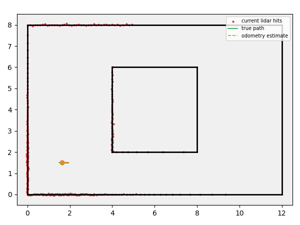
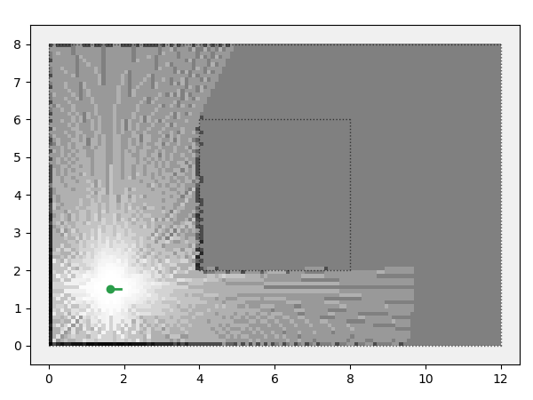
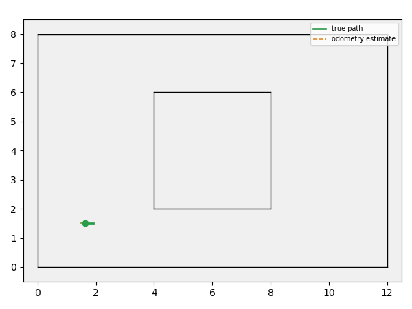
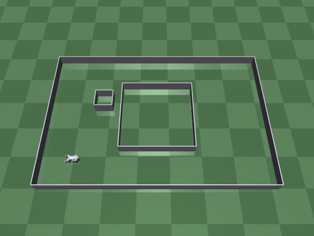
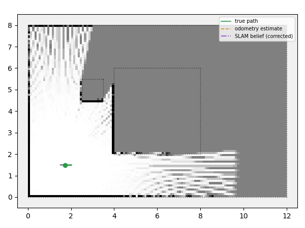
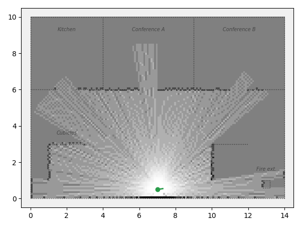

# 2D SLAM Sandbox

A from-scratch SLAM (Simultaneous Localization and Mapping) project: build the classical
occupancy-grid-mapping + scan-matching-localization pipeline from first principles, staged
and verified at each step.

A separate project (and repo) from `go1_rl_walk` (a sibling directory) — that project
trained a Unitree Go1/Go2 quadruped to walk and navigate (MuJoCo + PPO, then a classical MPC
controller) and ended with a working point-to-goal navigation stack, but every "obstacle
avoidance" mechanism there used privileged ground-truth or a short-range 9-ray near-field
fan built for footstep planning, not real mapping or localization. This project starts
over on the actual SLAM problem, deliberately away from that project's quadruped/MuJoCo
specifics:

- **Simplified kinematic robot, not the full quadruped.** A unicycle/differential-drive
  model with no mass, dynamics, or balance to fail — locomotion noise and falls would be a
  confounding variable while developing and debugging a mapping/localization algorithm, not
  a useful feature of this sandbox.
- **A real 2D lidar scan (360 beams), not a sparse near-field fan.** This is the standard
  sensor classical SLAM algorithms (GMapping, Hector SLAM, Cartographer) are built around —
  "richer sensing" than the quadruped project's own 9-ray fan was a deliberate choice, not
  an oversight carried over.
- **A world with a loop in it from the start** (a rectangular island obstacle inside an
  outer boundary, leaving a loop-shaped corridor around it) — loop closure is the
  signature hard problem in SLAM, so the sandbox is built to support it from Stage 1,
  rather than retrofitted later.

## Project summary

All 5 originally planned stages (1 through the loop-closure stretch goal) are done, plus a
sixth follow-on stage porting the pipeline onto a real robot. In order, each one fixes a
concrete failure the previous one exposed:

| Stage | What it adds | Result |
|---|---|---|
| 1. Simulator core | Kinematic robot + 360° lidar + a world with a loop in it | Odometry visibly drifts from true path over one lap (0.17m) |
| 2. Mapping (true pose) | Log-odds occupancy grid, perfect localization | 96.2% wall accuracy, 100% free-space accuracy |
| 3. Mapping (odometry pose) | Same mapper, fed drifting odometry instead | Wall accuracy collapses to 60.3% — drift corrupts the map |
| 4. Scan-matching (ICP) | Correct the pose every tick against the map built so far | Drift 0.132m → 0.065m; wall accuracy recovers to 79.5% |
| 5. Loop closure (stretch) | One ICP match to the start + batch pose-graph solve | Drift 0.327m → 0.055m; corrects the *whole* trajectory, not just the latest pose |
| 6. Real Go2 quadruped | Same Stage 2/4 pipeline, unmodified, on real MuJoCo dynamics + real lidar | Drift 1.178m → 0.038m over one ~39s lap in a richer world |
| 7. Office mission | Multi-room floorplan + a named-location "job" command layer | Drift 0.207m → 0.053m; wall accuracy 83.3% over a 5-stop tour |

The throughline: odometry alone drifts without bound (Stage 1/3); continuously correcting
against the map you're building helps a lot but is still a locally-greedy fix (Stage 4);
recognizing an explicit revisit and solving globally is what actually closes the loop
(Stage 5); none of it was specific to the toy kinematic robot it was developed against — the
same pipeline, unmodified, works on a real legged robot's real sensor stream (Stage 6); and
the same pipeline again, unmodified, is equally indifferent to *why* the robot is moving —
a scripted lap and a commanded office errand run are both just "a trajectory to correct"
(Stage 7). All seven stages are verified both numerically (printed accuracy/drift/RMSE) and
visually (every stage has a GIF — see below) — the two checks agree throughout.

## Staged plan

1. **Simulator core** (world, kinematic robot, lidar ray-casting) — DONE. Verified
   visually, not just by unit numbers: lidar hits should hug every wall tightly, and the
   dead-reckoning odometry estimate should visibly drift away from the true path over a
   lap — that drift is the whole reason the later stages exist.
2. **Occupancy-grid mapping, given the TRUE pose (perfect localization)** — DONE. Isolates
   the mapping half of the problem first, before localization noise is in the picture at
   all. Classical log-odds grid (the representation GMapping/Hector SLAM/Cartographer all
   build on): 96.2% of sampled wall points end up correctly marked occupied, 100% of known
   free-space points correctly marked free.
3. **Mapping from the NOISY odometry estimate instead** — DONE. Same mapper, same
   trajectory, only the pose fed to it changes (the lidar itself still senses from the true
   pose — only the mapper's BELIEF about where it is changes). Shows concretely how
   dead-reckoning drift corrupts a map over time: wall accuracy drops from 96.2% to 60.3%,
   and the mapped walls visibly separate from their true positions — motivating Stage 4.
4. **Scan-matching (point-to-point ICP) to correct the pose estimate against the map
   being built, closing the basic SLAM loop** — DONE. Every tick: predict (apply the
   odometry delta to a running belief pose) → correct (ICP-align the current lidar scan
   against the occupied cells mapped so far) → update the map with the corrected pose.
   ICP found enough map to correct against on 264/269 steps (the rest are the very start
   of the lap, before enough wall has been seen). Final position drift drops from 0.132m
   (raw odometry) to 0.065m (SLAM-corrected) — roughly half — and map wall accuracy
   recovers from Stage 3's 60.3% to 79.5% (short of Stage 2's 96.2% true-pose ceiling,
   since the correction is real but imperfect, not free).
5. **(Stretch) Loop closure / pose-graph correction** — DONE. Deliberately isolated from
   Stage 4's continuous correction: this demo's belief trajectory is raw, uncorrected
   odometry, so open-loop drift actually accumulates (odometry noise also turned up 4x
   from Stage 1-4's default, since at that default one lap's drift is already too small,
   ~0.15m, for loop closure's correction to be dramatic). Once the odometry estimate
   drifts back near the start, ICP matches the current scan against the very first
   keyframe's scan; if it converges, that single relative-pose measurement becomes a
   graph edge alongside the whole chain of odometry edges, and a batch least-squares
   solve (`slam/pose_graph.py`) redistributes the loop's accumulated error across every
   pose in between — not just the last one. Final position drift: 0.327m (odometry-only)
   → 0.055m (pose-graph-optimized); trajectory RMSE vs. ground truth: 0.162m → 0.102m.
6. **(Follow-on) The same pipeline, on the real Go2 quadruped** — DONE. See "Stage 6"
   below for the full writeup; the short version: Stage 2/4's occupancy grid + ICP
   correction run completely unmodified against a real MuJoCo lidar scan and real
   quadruped dynamics, and still cut final position drift from 1.178m (raw, noisy
   leg-odometry) to 0.038m (SLAM-corrected) over one ~39s lap.
7. **(Follow-on) A multi-room office floorplan with a named-location command layer** —
   DONE. See "Stage 7" below; the short version: kitchen, two conference rooms, a cubicle
   area, and a fire-extinguisher check spot, visited in any commanded order via the same
   Stage 2/4 SLAM pipeline, unmodified.

### Stage 1 demo

<p align="center">
  
</p>

Scripted waypoint-following (a turn-to-face-then-drive proportional controller, reused from
`go1_rl_walk/mpc/navigate_mpc.py`'s own steering law, which already proved itself there)
drives one full lap around the island. Lidar hits (red) hug every wall exactly as expected;
the true path (green, solid) and the dead-reckoning odometry estimate (orange, dashed)
start overlapping and visibly diverge over the lap — real, not simulated-for-effect, drift
from the odometry noise model in `slam/robot.py`.

```bash
pip install -r requirements.txt
python3 demo_stage1_sim.py --record media/stage1_sim_and_drift.gif
```

### Stage 2/3 demo: mapping, and what drift does to it

<p align="center">
  
  
</p>

*Left (Stage 2, true pose): walls come out crisp and exactly matching ground truth; the
island's interior is correctly left unknown (gray) — the lidar never sees inside a solid
obstacle. Right (Stage 3, odometry pose): identical mapper and trajectory, only the pose
fed to it differs — the mapped walls (solid black) visibly separate from their true
positions (dotted gray overlay) as odometry drift accumulates over the lap. This is the
concrete failure Stage 4's scan-matching correction exists to fix.*

```bash
python3 demo_stage2_mapping.py --pose-source true --record media/stage2_mapping_true_pose.gif
python3 demo_stage2_mapping.py --pose-source odom --record media/stage3_mapping_odom_drift.gif
```

### Stage 4 demo: closing the loop with scan-matching

<p align="center">
  
</p>

Same mapper, same trajectory, but now the pose fed to the map is a `belief_pose` that gets
corrected every step: a lidar scan is aligned (point-to-point ICP, `slam/scan_match.py`)
against the occupied cells of the map built *so far* ("scan-to-map" matching, the same
style Hector SLAM/Cartographer's local matcher use), and the corrected pose both drives the
next map update and seeds the next prediction. ICP had enough map to correct against on
264/269 steps — the rest are the very start of the lap, before enough wall has been seen,
during which belief_pose just follows the raw odometry prediction (identical to Stage 3).
Final position drift: 0.065m (SLAM-corrected) vs. 0.132m (raw odometry) — roughly half.
Wall accuracy: 79.5%, up from Stage 3's 60.3%, though short of Stage 2's 96.2% true-pose
ceiling — the correction is real, but not free of its own residual error.

```bash
python3 demo_stage4_slam.py --record media/stage4_slam_corrected.gif
```

### Stage 5 demo (stretch): loop closure

<p align="center">
  
</p>

This demo turns up odometry noise and skips Stage 4's continuous correction on purpose, so
open-loop drift has a chance to actually accumulate (orange path visibly separates from
green over the lap). Once the odometry estimate comes back near the start, ICP matches the
current scan against the very first keyframe's scan; the resulting relative-pose
measurement becomes a loop-closure edge in a pose graph alongside the whole chain of
odometry edges, and a batch least-squares solve corrects every pose in the trajectory at
once — the final few frames morph the raw odometry trail into the optimized one to make
that "closing" event visible as something that happens, not just a changed number. Final
position drift: 0.327m (odometry-only) → 0.055m (pose-graph-optimized).

```bash
python3 demo_stage5_loop_closure.py --record media/stage5_loop_closure.gif
```

### Stage 6: the real Go2 quadruped, in a richer world

<p align="center">
  
  
</p>

Every stage above uses this project's own simplified kinematic unicycle robot, deliberately
isolating the SLAM algorithm from locomotion noise. This stage asks the opposite question:
does the Stage 2/4 pipeline (occupancy grid + ICP correction) still work completely
unmodified against a REAL robot? It's pointed at the actual Unitree Go2 quadruped from the
sibling `go1_rl_walk` project (real MuJoCo rigid-body dynamics, real convex-MPC
balance/footstep control, zero kinematic idealization) via `slam/mj_lidar.py` (a true
`mujoco.mj_ray` 2D lidar cast against real wall geometry injected into the scene) and a
synthesized "leg odometry" (the robot's own realized body-frame velocity, corrupted by the
same noise model `slam/robot.py` uses — so real stance-phase dynamics contribute to the
drift, not just an injected random walk). The world is a step up from Stages 1-5's single
rectangle-with-an-island: the same loop corridor, plus a second, free-standing pillar
obstacle placed well clear of the scripted route (no new obstacle-avoidance/path-planning
logic needed or added — deliberately out of scope, same as `go1_rl_walk`'s own closing
decision).

Over one ~39s lap: final position drift 1.178m (raw, noisy leg-odometry) → 0.038m
(SLAM-corrected) — more than 30x — with ICP finding enough map to correct against on
778/779 lidar scans. Wall accuracy 73.3% (short of the kinematic-robot Stage 2's 96.2%
ceiling — a coarser 180-beam lidar and real dynamics noise are both harder than the toy
sim, as expected, but the correction is still clearly working, visible in the GIF as the
purple SLAM-belief trail hugging the true path while raw odometry visibly balloons outward
on the far turns).

```bash
# Needs go1_rl_walk/mpc's own venv (casadi/pinocchio/convex_mpc), not this project's
# requirements.txt -- see go1_rl_walk/mpc/README.md.
/home/cstu/robo/go1_rl_walk/mpc/venv/bin/python3 demo_stage6_go2_world.py \
    --record-map media/stage6_go2_slam_map.gif --record-robot media/stage6_go2_quadruped.gif
```

### Stage 7: an office floorplan, with commands

<p align="center">
  
</p>

Every stage above drives one fixed, pre-scripted lap. This stage asks a different question:
can the same pipeline support an actual *command* -- "go here, do this job, then go there" --
instead of one baked-in trajectory? `slam/office.py` builds a richer ground-truth world (a
kitchen, two conference rooms, and an open cubicle/corridor area with a fire-extinguisher
cabinet, all behind real doorways) plus a small named-location registry: each job name
(`kitchen`, `conference_a`, `conference_b`, `cubicles`, `fire_extinguisher`) maps to a
hand-placed path from a shared hub waypoint to that spot, a short task description, and a
dwell time. `--jobs` takes any ordered subset in any order, builds one waypoint mission out
of it, and the robot drives it exactly like Stages 1-5's scripted lap -- same
`slam/trajectory.py` steering law, same occupancy-grid mapping, same ICP scan-to-map
correction, all completely unmodified. While dwelling at a job the robot is genuinely
stationary (no commanded velocity) but keeps scanning and correcting every tick, so standing
still to "do the job" also means standing still to get a good fix on the room.

One real wrinkle this layout exposed: the shared map-accuracy scorer's wall-sample heuristic
(`slam/eval.py`) picks which side of a zero-thickness wall to sample by guessing "whichever
side faces the map's overall centroid" -- a fine proxy for Stage 1-6's outer-boundary-heavy
loop_corridor (the robot only ever approaches from the one inside direction), but wrong half
the time for an office with walls that have open rooms on *both* sides. Fixed with an
opt-in `wall_both_sides` scoring mode (score each sample against whichever of its two
neighboring cells is more occupied, rather than guessing one) -- confirmed the underlying
map was correct all along (manually checked the exact occupancy-grid cells around a
divider wall) and this was purely an evaluation-heuristic gap, not a mapping bug. Stage
1-6's own numbers are untouched (that mode defaults off).

Over a 5-stop tour (kitchen, both conference rooms, cubicles, fire extinguisher, in that
order): final position drift 0.207m (raw odometry) → 0.053m (SLAM-corrected); ICP found
enough map to correct against on 1026/1027 ticks; wall accuracy 83.3%. Verified visually via
GIF: every room's doorway, the cubicle dividers, and the fire-extinguisher cabinet all come
out crisp in the occupancy grid, and the yellow status banner ("Making coffee...",
"Attending a meeting...", ...) visibly pauses the trail at each stop.

```bash
python3 demo_stage7_office.py --jobs kitchen conference_a conference_b cubicles \
    fire_extinguisher --record media/stage7_office_tour.gif
# Or any subset/order -- e.g. just two stops:
python3 demo_stage7_office.py --jobs fire_extinguisher kitchen --record media/my_run.gif
```

## Repository layout

```
slam_sim/
├── slam/
│   ├── world.py          # ground-truth 2D map: wall line segments, free-space check
│   ├── robot.py           # unicycle kinematics, true pose vs. noisy dead-reckoning odometry
│   ├── lidar.py            # 360-beam ray-casting sensor against the world's walls
│   ├── occupancy_grid.py    # log-odds occupancy-grid mapping (Bresenham ray rasterization)
│   ├── scan_match.py          # point-to-point ICP: align a scan against the map built so far
│   ├── pose_graph.py           # batch least-squares pose-graph optimizer (Stage 5)
│   ├── mj_lidar.py              # real mujoco.mj_ray 2D lidar scan (Stage 6, real robot)
│   ├── office.py                 # office floorplan + named-location/job registry (Stage 7)
│   ├── trajectory.py         # shared scripted loop (reused by every stage demo)
│   ├── eval.py                 # shared map-accuracy scoring (reused by every mapping demo)
│   └── viz.py                  # render a frame (world + poses + scan + map) -> GIF
├── demo_stage1_sim.py    # Stage 1 demo: scripted loop, verifies the simulator itself
├── demo_stage2_mapping.py # Stage 2/3 demo: mapping from true pose vs. noisy odometry
├── demo_stage4_slam.py     # Stage 4 demo: ICP scan-matching correction, closing the loop
├── demo_stage5_loop_closure.py # Stage 5 demo: loop closure + pose-graph optimization
├── demo_stage6_go2_world.py     # Stage 6 demo: same pipeline, real Go2 quadruped (MuJoCo)
├── demo_stage7_office.py          # Stage 7 demo: office floorplan + named-location jobs
├── media/              # demo GIFs, one per stage
├── requirements.txt
└── README.md
```
